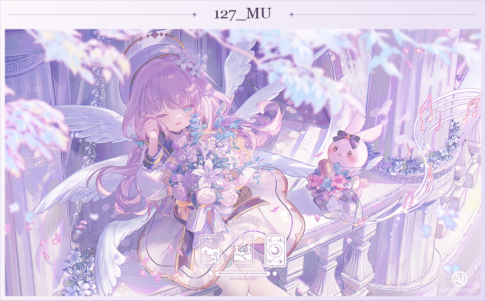

<h1 align="center">
  
</h1>

做一些游戏模组和桌面工具。

  
  

  <a href="https://github.com/127MU">@127MU</a>
  &nbsp;·&nbsp;
  <a href="https://github.com/127MU?tab=repositories">全部仓库</a>

## 精选项目

<table width="100%">
  <tr>
    <td width="50%" valign="top">
      <h3><a href="https://github.com/127MU/SHODAN-Stat-Editor">SHODAN Stat Editor</a></h3>
      
编辑《绝地潜兵 2》的武器、战备和护甲数值。

      

      
<a href="https://github.com/127MU/SHODAN-Stat-Editor/releases/latest">下载最新版 ↗</a>

    </td>
    <td width="50%" valign="top">
      <h3><a href="https://github.com/127MU/custom-planets-variants">自定义星球和变种</a></h3>
      
为《绝地潜兵 2》配置并保存星球和变种方案。

      

      
<a href="https://github.com/127MU/custom-planets-variants/releases/latest">下载最新版 ↗</a>

    </td>
  </tr>
</table>

## GitHub 活动

  

---

  插画署名见图内

